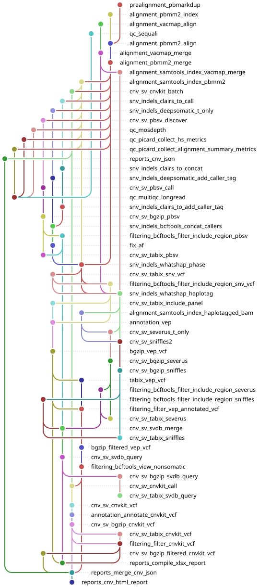

# Minerva


[](https://opensource.org/licenses/gpl-3.0.html)


<p align="center">
  <picture>
    <source media="(prefers-color-scheme: dark)" srcset="images/minerva_logo.svg">
    
  </picture>
</p>


## Introduction

Minerva is a bioinformatic pipeline for detecting high-risk genomic markers in multiple myeloma (MM). Minerva is built using [hydra-genetics modules](https://github.com/hydra-genetics) and designed to analyse hybrid capture long-read sequencing data (PacBio HiFi) from gene panels. It uses two aligners: [VACmap](https://github.com/micahvista/VACmap) to increase sensitivity of SV-detection, and [pbmm2](https://github.com/PacificBiosciences/pbmm2) for SNVs/InDels and copy number variants (CNV). For the full list of tools, see [Documentation](https://minerva-pipeline.readthedocs.io/en/latest/).

## Dependencies

All dependencies are managed by [pixi](https://pixi.sh). Install pixi, then run:

```bash
pixi install
```

This resolves and installs all required packages (Python, Snakemake, hydra-genetics, and other tools) as defined in `pixi.toml`. Container images for individual pipeline tools are pulled automatically at runtime via Singularity/Apptainer and are listed in `config/config.yaml`.

## Preparing inputs

### Input files

The `samples.tsv` and `units.tsv` are input files that must be generated before running the pipeline from BAM files using hydra-genetics' [create input files tool](https://hydra-genetics.readthedocs.io/en/latest/run_pipeline/create_sample_files/). For further information see [Setup](docs/setup.md#input-files).


## Dry run

The pipeline uses [pixi](https://pixi.sh) for environment management. Run a test dry-run locally:

```bash
pixi run test-dry
```

A small test dataset is also available in `.tests/integration/`.

## Real run

```bash
# Dry run
pixi run all-dry

# Full run (SLURM cluster)
pixi run all-full
```

Refer to [running the pipeline](docs/running.md) for more information.

### Output files

The pipeline produces a number of output files includong BAM and VCF files, HTML- and Excel-reports. The exact files can be configured via [output config](config/output_files.yaml).

Full list of outputs [is available here](docs/result_files.md), also refer to the [output section here](docs/running.md#output).

## Rule Graph

<picture>
  <source media="(prefers-color-scheme: dark)" srcset="images/rulegraph_snakevision_dark.svg">
  
</picture>
